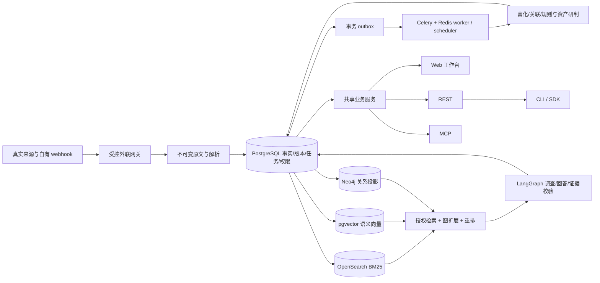

# 完整交付恢复计划：从当前代码到赛题九与新规划的全部效果

日期：2026-10-14。基线：`main@8e265dc039a67319140f003f6a070ea714bf7bef`。

文档状态：**提案，awaiting_review**。本次工作是细查规划、官方题目和代码后制定执行方案，未开始本方案的产品开发，未改写已有任务验收状态。本方案与原冻结合同冲突的部分，统一通过下文 R00 的变更记录生效，不以本文件的存在视为已批准。

配套文件：[现状审计](../../reports/reviews/PLAN-AUDIT-20261014.md)、[执行任务卡](12_recovery_task_cards_20261014.md)、[本轮证据](../../reports/runs/plan_audit_20261014/)。原有 [60 张任务索引](00_execution_map.md)、[评分合同](01_scope_and_scoring.md)、[评测合同](06_testing_and_evaluation.md)继续保留。

## 1. 判断与执行策略

当前仓库是“有基础合同、部分持久化能力和较多纯逻辑测试的早期实现”，尚未形成可用的情报产品。不能用 `24/60 accepted` 推导完成度为 40%，也不能把剩余工作理解成接几个密钥和补前端。默认应用只有两个健康检查路由；来源采集、真实模型、事实持久化和用户页面尚未贯通。具体复现和代码位置见审计报告。

新规划的主线值得保留：AI 安全垂直情报、无 CVE 公告、九维富化、可解释关系图、多跳问答、版本自查、MCP/CLI/SDK 和可扩展插件。原仓库合同中更严格的证据、四态研判、历史版本、权限、更新重判与盲测要求也必须保留。两者合并后的目标是一个能持续运行、能回答真实问题、能解释失败与未知、能被第三方 Agent 调用且有真实评测证据的完整系统。

执行顺序改变为：**先打通一个小而真实的全链路，再扩大覆盖和深度，持续积累运行证据，最后冻结评测与交付材料**。第一条链必须同时经过真实来源、数据库、真实模型和真实页面；仅实现解析函数、fixture 测试、架构图或静态页面不算里程碑。

用户接受由 Codex 高强度连续推进约三天，费用不是压缩范围的理由。本计划把 72 小时作为首轮集中交付窗口，而不是“届时无条件宣布完成”。未达到的效果继续保留为必做项；准确率、召回率、来源可用性和真实运行时长不能通过增加模型调用量保证。

## 2. 官方要求和两份规划如何合并

官方依据为仓库内四页赛题 PDF；根目录副本 SHA-256 为 `37f28bc38db91ec0407551b1254c8bc882432a8488ce896c681e1210814c6cf3`。附件中的已有实测文字仅作为附件作者的历史记录，本轮没有据此认证当前凭据、网络或产品已接通。

| ID | 初赛 / 决赛分值 | 必须交付的效果 | 本计划责任任务 | 最终证据 |
|---|---:|---|---|---|
| F1 | 15 / 10 | 至少七类来源、持续自动采集、实时或准实时更新、去重；论文、标准、政策有内容 | R03–R06、R09、R22 | 来源类别登记、真实运行日志、修订与去重案例 |
| F2 | 15 / 10 | 多维富化、自动关联、影响和修复分析 | R07、R08、R10、R11、R13 | 九维适用矩阵、关系证据、版本与资产结果 |
| F3 | 15 / 10 | 多轮、跨文档、多跳与深度分析；决赛个性化推荐 | R12–R17 | 带引用回答、必要证据删除实验、不同用户推荐 |
| P1 | 5 / 5 | ≤6h 时效目标与稳定性；发布/发现/入库时间分别保留 | R06、R20–R22 | 独立参考集合、延迟分布、超时和漏采、真实运行跨度 |
| P2 | 5 / 5 | 初赛准确率≥95%；决赛准确率和召回率均≥95% | R07、R10、R11、R19、R21、R22 | 冻结分母、事实/关系/事件覆盖、逐维度误差 |
| P3 | 5 / 10 | 初赛多跳准确率≥85%；决赛准确率≥95%且可解释，记录完整响应时间 | R12、R14、R15、R19、R21、R22 | 逐题结果、引用支持、冷热缓存及并发延迟 |
| A1 | 15 / 15 | 有真实职责、工具选择、持久化和可扩展性的 Agent 协作，效果有对照 | R14、R18、R21 | 可审计任务轨迹、同条件基线/消融、新插件演示 |
| E1 | 10 / 10 | 端到端自动化、自愈、CI/CD、自动运维和恢复 | R01–R03、R06、R16、R20、R23 | 干净环境部署、故障演练、备份恢复与流水线 |
| D1 | 15 / 10 | 与实际实现一致的技术文档 | R24 | Word+PDF 报告、接口/插件文档、复现说明 |
| D2 | — / 10 | 完整演示与有证据的答辩 | R17、R22、R24 | 视频、匿名 PPT、演示录像、问答材料 |
| X1 | — / 5 | 创新、系统性、实用性、协作 | R14、R16、R18、R21、R23、R24 | 对照结果、变更/评审记录、可复现扩展案例 |
| R1 | 不另计分 | 论文、技术标准、政策法规与 AI 安全风险知识 | R04、R09、R12 | 各类真实资料与可追溯问答 |
| R2 | 不另计分 | 自行部署；报告 Word+PDF、视频、初赛 PPT 的 PDF、决赛主办模板和匿名要求 | R20、R23、R24 | 提交清单和实际文件，模板未提供时明确阻塞 |

两阶段各 100 分，不能沿用附件中只有初赛权重的一张自评表。官方未明确所有聚合口径：同时报告发布至入库、首次发现至入库和可问答完成延迟；不以 P95 合格代替全部记录合格。≤5 秒出现在决赛问答合格档，优秀档没有重复该限制；仍必须测完整回答耗时，不能拿首字、HTTP 202 或任务提交耗时替代。

## 3. 最终用户能完成什么

下面的 U01–U14 都是最终范围，阶段先后不代表后面的功能可删。

| 场景 | 用户操作与可见结果 | 验收条件 |
|---|---|---|
| U01 新情报发现 | 打开工作台看到真实来源更新、时间、状态和延迟；无 CVE 公告也能打开 | 实际轮询触发入库，重启不丢游标，重复采集不重复建事件 |
| U02 情报证据详情 | 查看九维富化、各维状态、来源原文与版本 | 每个事实可定位；未发现、失败、不适用、冲突分别展示 |
| U03 关联图谱 | 点击漏洞与组件、论文、ATLAS、处置之间的边查看理由 | 自动生成，理由指向证据；模型推测与确认边明确区分 |
| U04 依赖版本自查 | 上传受支持清单或输入组件/版本，获得影响、修复和依据 | 生态正确；未知不会变为“安全”；没有命中不等于确定排除 |
| U05 资产研判 | 两个版本/配置不同的授权资产得到不同、可解释的结论 | 四态、条件树、资产快照、规则版本、证据包与受限 OpenVEX |
| U06 深度问答 | 单文档、多轮、时间范围、多跳、机制与政策问题能完成 | 每个关键论断有支持证据；缺必要证据能保留未知 |
| U07 个性化推荐 | 不同用户按资产、关注对象和主题收到不同建议 | 理由可核查，退订有效，重复提醒受控，原结论撤回同步更新 |
| U08 变化与历史 | 公告扩大影响范围、修复版本变化或新增资产后看到重判 | 同时覆盖旧命中、新命中、旧空结果；历史可查询 |
| U09 Agent 任务追踪 | 打开任务树查看角色、工具、状态、证据与停止原因 | 展示实际执行记录；中断恢复不重复产生副作用 |
| U10 运维闭环 | 查看来源失败、积压、重试、死信和恢复；执行受控重放 | 恢复后结果与正常流程一致；没有假绿灯和假进度 |
| U11 外部 Agent 接入 | Codex/Claude Code 调用 MCP 查询、自查、问答与任务轮询 | 在实际客户端完成，鉴权与权限有效；其余客户端分项认证 |
| U12 CLI/SDK/插件 | CLI 可在 CI 使用，SDK 可调用；新增来源或富化插件不改核心 | 三类扩展点有真实样例、权限隔离和兼容性测试 |
| U13 日报/周报 | 生成可下载报告，摘要能跳回证据和当前结论 | 从真实库生成，带数据时刻；日报不复活已撤回结论 |
| U14 比赛交付 | 在新环境启动产品，复现核心场景，打开评分证据与材料 | 技术报告、演示、视频、匿名材料、代码版本和评测一致 |

## 4. 现有代码保留、补强和重开范围

| 范围 | 当前事实 | 后续处理 |
|---|---|---|
| T00–T04 | 有合同、骨架、枚举、质量命令和依赖锁定 | 保留；R00 对齐新增范围，R01 修正检查入口与服务部署 |
| T05 | 有 PostgreSQL 迁移、不可变原文和修订相关实现 | 保留并在隔离真实数据库复跑；扩展到全部知识事实 |
| T06 | 有密码、权限、用户目录、认证路由；默认应用未装配，部分会话/审计驻内存 | R01/R02 接通并持久化，多进程测试，不另写第二套认证 |
| T07 | 有 SQL jobs/outbox，是可复用基础 | R03 验证租约、延迟重试、竞争提交与 Celery 实际消费 |
| T08–T16 | 网关/解析/归一化等局部代码存在；持续真实采集链缺失，PDF/NVD 有实证错误 | 按 R03–R06 重开集成验收；保留正确纯函数，替换不真实的实现 |
| T18 | 验证器和 FixtureProvider 存在，真实模型调用接口缺失 | R05 实现真实生成、向量和重排；不能只记 blocked_live |
| T17、T19–T23 | 部分关联/富化逻辑可复用，核心账本驻内存，九维不完整 | R02、R07–R10 扩展并真正持久化、调度与发布 |
| T24–T39 | 状态 pending；核心资产、版本、检索、问答、Agent、更新与推荐尚待建设 | R11–R16、R13 按依赖实现，不因新方案漏写而移除 |
| T40–T44 | 前端目前为极小骨架；有认证后端准备，但产品页面未建成 | R04 起逐条闭环接 UI，R17 完成统一体验 |
| T45–T59 | 正式安全、性能、盲测、部署、运行与材料尚待完成 | R19–R24，从第一天积累证据，最后独立核验 |

R00 创建逐任务复核表；每条记录 `implementation / verification(unit,contract,integration,live,manual) / evidence / reopen_reason`。有错误实现的任务标 needs_changes；外部尚未测的能力才标 blocked_live。旧 accepted 历史不删除，追加更正记录并经审查更新状态，防止后续继续沿用虚假前置。

## 5. 架构取舍：一个业务核心，所有入口共享

- 沿用 FastAPI、Python、React/TypeScript 的模块化单体；同一业务服务供 API、MCP 和任务调用。新增能力按模块落地，不拆一批微服务。
- PostgreSQL 是事实、任务、租户、依赖、规则与有效状态的唯一权威。向量、全文和图均为可重建投影。召回后回查数据库当前版本和权限；索引落后不返回已知失效结论。
- 按新规划引入 pgvector 作为唯一语义向量存储，OpenSearch 保留 BM25；不同时维护两套语义索引。pgvector 的模型维度、模型版本和重建策略随索引版本冻结。其向量类型与索引能力以[官方仓库](https://github.com/pgvector/pgvector)为依据。
- 为落实显式图检索和图谱展示，引入 Neo4j 投影，但图边先在 PostgreSQL 审核与版本化，再由 outbox 投影；绝不让 GraphWriter 绕过事实合同。图谱不可用时标降级，不能把无图检索的结果计为 GraphRAG 实测。
- 消息执行统一 Celery+Redis，复用现有 jobs/outbox；不再同时引入 Streams、NATS、Kafka。附件的消息队列效果通过可靠投递、幂等、重试、死信和恢复实现。
- 原文字节和导出报告采用内容寻址对象存储接口；保留当前本地实现供测试，部署使用 MinIO 适配。先保存可校验字节再提交元数据，孤立对象可回收，已引用对象不可变。
- LangGraph 检查点采用数据库持久化；只保存工作流进度，不代替业务事务。官方文档区分内存与数据库 checkpointer，执行时必须验证跨进程恢复：[LangGraph persistence](https://docs.langchain.com/oss/python/langgraph/persistence)。
- Prometheus/Grafana 负责运行指标；模型/工具追踪记录在本项目任务表，并接 Langfuse 供调试。日志、trace 和提示词均需脱敏。依赖版本在 R00/R01 验证后锁定，不在计划里编造未验证兼容版本。

这比原仓库首版多了 pgvector、Neo4j、MinIO 和追踪服务，属于明确架构变更。其理由是承接新规划所要求的真实语义检索、图扩展、原文对象存储和执行追踪；不是为了把组件名称堆满。先让每个组件服务于可验收场景，再纳入部署。

## 6. 来源、富化和证据的落地细节

### 6.1 来源类别和采集通道分开统计

官方类别沿用原合同的八类：结构化漏洞、厂商公告、安全社区、项目仓库、技术博客、论文、标准、政策。附件九条通道作为 connector 清单，不能直接宣称九个互不重叠的官方类别。

| 业务通道 | 实现策略 | 官方类别映射与限制 |
|---|---|---|
| CVE/NVD | 根据真实 API 响应实现分页、更新时间窗口、修订与回补 | 结构化漏洞；先修复已证实的 NVD 层级和 CVSS 取值错误 |
| GHSA/OSV | 分开实现公告同步与包版本富化，保留别名和生态 | 结构化漏洞/安全社区需明确归属，不重复凑类别 |
| 厂商公告/项目 release | 固定产品配置；P0 每 5 分钟、P1 每 30 分钟的建设目标；遵守来源限额 | 厂商公告、项目仓库需各有真实入口；第三方仓库默认轮询 |
| huntr/AVID | 允许公开页面或官方公开数据仓库；无权接口记阻塞 | AI 专属平台是垂直特色，不天然等于独立官方类别 |
| KEV/EPSS | 拉取真实数据版本与日期，作为富化状态更新 | 辅助富化源；“未列入”只针对所用快照，不宣称无在野利用 |
| 博客/RSS | RSS 发现 + 正文抓取 + canonical URL 与内容版本 | 技术博客；先验证实际 feed，不照搬附件的失效 RSS |
| arXiv/论文 | API/RSS/已授权检索回补，论文版本与证据定位 | 学术论文；日更发现难以证明≤6h，目标发现周期≤1h，受配额限制则披露 |
| CNNVD/CNVD | 先查当前官方入口与授权方式；可用公开入口增量，人工导入另标 | 国内来源冗余；不把手工导入计为全自动，不绕过验证 |
| 标准/政策/ATLAS | 标准与政策分别登记官方文档和更新入口，版本监测 | 标准、政策分别有真内容；ATLAS 是知识体系，不替代政策法规 |

先选择 3 个有可靠资料的 AI 产品形成纵深案例，再扩至 5 个；建议从 Ollama、vLLM、Dify、ComfyUI、Triton 的真实资料中核定。包名、部署产品名、版本体系分别建模，不把 Ollama 自动当成同名 PyPI 包。无 CVE 公告使用稳定内部 ID 与公开别名，后补 CVE 不更换主键。

所有 poll/backfill 经统一网关；每个来源保存游标、ETag、Last-Modified、重叠窗口、下次调度时间、失败分类与最后成功时间。单页内容、修订和 outbox 成功提交后才推进游标。重启、重复投递、分页中断、A→B→A 修订必须实测。第三方短周期轮询与自有 webhook 分别标注；附件“3 类事件驱动实时通道”的话术不直接采用。

对所有纳入时效评分的发现源，目标轮询间隔不超过 1h；P0 更短。EPSS 等上游本身日更的数据区分“上游生成周期”和“本系统发现延迟”，不能借辅助源名义排除本应统计的新公告。因来源限制做不到的记录偏差，不承诺未经实测的≤6h。

### 6.2 九维富化和六类关联

九维全部实现：CVSS、EPSS、KEV、CWE、ATLAS、受影响/修复版本、论文/分析文章、PoC/检测模板存在性、公网暴露统计。每维封装现有 `DimensionStatus`，携带数据版本、观察时间、证据、错误分类与新鲜度。修复建议、影响机制和政策/标准知识卡另行保留，不能被九维统计挤掉。

| 维度/关系 | 发布条件 |
|---|---|
| CVSS、EPSS、KEV | 保留来源、版本/日期；不同评分并存；无 CVE 的演示公告不能伪造真实 EPSS/KEV |
| CWE、ATLAS | 标准 ID 校验；文本相似度仅产生候选；关联需要适用机制与原文证据 |
| 版本和处置 | 生态专用比较器、版本区间和配置条件；区分厂商修复与一般缓解建议 |
| 论文/分析关系 | 组件与风险机制共同支持；“讨论同一主题”不等于“证明同一漏洞” |
| PoC/模板存在性 | 元数据、URL、标题和静态核查状态；不执行下载的代码，不称验证利用成功 |
| 暴露统计 | Hunter/Quake 接口实际探测后接入；查询模板、时间、总数与局限可见；服务数量不等于受影响数量 |

六类关系为同事件多源合并、漏洞→组件/版本、漏洞→ATLAS、漏洞→论文、漏洞→处置、组件版本→漏洞清单。规则强关联与模型候选分开；每条发布边携带 `relation_type, source_revision, evidence_span_ids, rule_or_model_version, reason, status`。对将进入事实库和回答的关键关系逐条做证据和结构校验；抽检可用于质量监控，不能代替发布校验。

来源等级只决定展示优先候选，不自动抹掉冲突。对版本、修复和撤回这种高影响字段，不把不同范围简单并集、不因任一源 withdrawn 就全局撤回、不把模型自信度当事实置信度。保留每个来源的断言和生效区间，必要时输出 conflicting_evidence。

### 6.3 公网统计与授权资产是两条独立链

公网暴露面只请求、保存和输出聚合结果，默认拒绝明细；若供应商接口不可避免带明细，在受控网关立即丢弃且不写日志、缓存、提示词。schema 白名单比“看起来像 IP 的正则”更可靠，后者还可能误删版本号。无可靠版本/条件依据时 `vulnerable_estimate` 不填，不把宽泛搜索计数展示为漏洞资产数。

原合同的 FOFA 授权资产观察继续保留：仅针对用户已授权资产范围，以租户权限、观察时间和资产快照控制，用于资产研判。它不能被公网统计替代。具体供应商缺凭据时完成代码与合同测试，live 保持阻塞；不默认账号已可用，也不把附件的历史额度/网络记录当本机事实。

## 7. 问答、Agent、变化和产品体验

### 7.1 真实检索与回答

检索首先应用租户、可见性、版本和时间约束，再执行精确 ID/BM25、真实语义向量和图扩展；RRF 融合、真实 reranker 重排。初始候选规模 top-50、图 1–2 跳、上下文 8–12 chunks 可作为开发参数，最终由开发集调整后冻结，不当作已经最优。

先建立能稳定回答事实问题的真实模型基线，再增加子问题规划、证据缺口调查、版本工具和多跳拼接。每个关键论断附引文和支持判断，侧栏打开原文版本与片段。校验失败只允许有限补检索；仍不足就明确缺口，不生成看似完整的模板答案。

“可解释推理链”展示子问题、工具、证据、条件判断和结论依赖，不要求泄露模型内部思维链。深度任务走持久化异步作业；用户能看到实际步骤、取消任务、重试失败阶段。快速模式以完整回答≤5秒为优化目标，深度模式如实报告完成时间。

### 7.2 九个角色的真实职责

| 角色 | 实际责任 | 验证点 |
|---|---|---|
| Orchestrator | DAG、缺口优先级、预算、停止和恢复 | 非固定聊天接力；工具选择和停止可解释 |
| Collector | 发现、抓取、游标和来源状态 | 确定性工具节点，不为抓网页额外调用 LLM |
| Triage | AI 相关性、归并候选和风险标签 | 召回与误报可测，错合并可撤销 |
| Enricher | 九维及跨文档候选 | 部分成功可保留，每维状态独立 |
| GraphWriter | 将已批准关系投影到图 | 确定性写入，不让 LLM 任意写 Cypher/事实 |
| Assessor | 版本/条件与资产评估、优先级解释 | 四态、证据包、快照提交校验 |
| QA | 规划检索、答案组织、多轮上下文 | 引用支持、时间/权限范围和多跳必要性 |
| Critic | 关键论断、关系与引用校验 | 不能仅检查“引用存在”；校验结果本身可审计 |
| Reporter | 日报/周报和可导出摘要 | 来自有效事实，保留来源和数据截止时间 |

角色数不是效果指标。对照保留单 Agent、固定四角色、固定九角色与动态缺口调度，使角色拆分和调度策略的影响分别可测。工具权限、调用量、输出大小、时长均设上限，即使费用预算宽裕也不无限循环。

### 7.3 变化传播和个性化

每个回答、研判、推荐记录引用依赖、检索范围关注和空结果依赖。原文、规则或资产变化后，先将受影响结果标 stale，再调度局部重算；同时寻找新命中，不能只追踪旧引用。查询返回前复核有效状态，晚到的旧任务不得覆盖新快照。历史按业务生效时间和系统记录时间查询。

推荐来源包括用户明确关注、资产组件、风险主题和已授权交互信号。先做有解释的确定性排序，再根据验证数据改进；不需要一开始训练推荐模型。不同用户、退订、去重、撤回和跨租户隔离均有端到端测试。

### 7.4 页面按真实使用顺序交付

先做登录→来源→列表→详情→引用，随后做问答→版本自查/资产→图谱→任务与运行→推荐/日报。最终态势大屏使用已存在的真实指标。页面通用状态必须包括加载、空、无权限、部分成功、过期、外部失败和待人工处理；所有截图和录屏来自真实页面。

体验验收：核心操作可从导航找到；详情、图谱、答案和研判之间能互跳；刷新/重启保留任务；引用打开正确版本；没有点击后静默无反应的按钮；窄屏可操作、键盘可用、长文本不遮挡证据。

## 8. MCP、REST、CLI 与插件生态

共享业务入口提供 `search_vulns`、`get_vuln`、`check_stack`、`ask`、`get_task_result`、`list_sources` 六个只读工具；`subscribe_alerts` 作为可配置第七工具，仅写当前用户订阅。网页可创建同样订阅。Streamable HTTP 与 stdio 采用[官方 Python MCP SDK](https://github.com/modelcontextprotocol/python-sdk)，实际依赖版本由实施时验证并锁定。

公共 schema 保留附件的八类业务对象（NormalizedIntel、Vulnerability、Advisory、Component、Enrichment、Relation、Citation、QAAnswer）及 common 定义，以适配层映射内部证据/版本/权限合同。公开 schema 不得成为绕开内部租户校验的写入入口。OSV/STIX 2.1/CSAF 2.0 导出标明支持子集和未映射字段，不宣称无损全标准支持。

必须先修正公共合同：

1. `ask` 使用带判别字段的完成结果/任务句柄联合类型；异步结果不能同时强制要求 answer/citations。
2. `check_stack` 结果保留四态及 unsupported、无匹配等原因；不使用含糊的 `clean` 表示安全。CLI 的“无高危命中”退出码与“不确定/执行失败”分开定义并文档化。
3. 输入上限与异步上限一致：不能 schema 限制 200 项却声称同一数组超过 200 项自动转任务。R00 选择受限大清单上传并异步解析的路线，分别写入字节/条数上限。
4. RawEvent 负责原文获取与不可变引用；NormalizedIntel 负责归一化输出。插件返回两者关联的受控结果，不让同一接口文档对输出类型有两种说法。
5. 8k tokens 输出预算、分页和截断不截断单条事实证据关系；结果保留可继续获取的游标/引用。
6. stdio 的 stdout 仅输出协议，日志走 stderr；远程认证、API Key 哈希、轮换、撤销和限流都经共享认证服务。租户来自认证上下文。

REST沿用附件路径：`GET /api/v1/vulns`、`GET /api/v1/vulns/{id}`、`POST /api/v1/stack/check`、`POST /api/v1/ask`、`GET /api/v1/tasks/{task_id}`、`GET /api/v1/sources`、`/api/v1/subscriptions`和`GET /api/v1/reports`。采用OpenAPI 3.1，错误统一为RFC 9457的`application/problem+json`；流式回答与异步句柄各有合同。自有GitHub webhook校验签名、防重放；`/internal/simulate`仅限隔离demo环境和管理员，生产不能匿名注入。

插件提供 SourceConnector、Enricher、Tool/Skill 三类真实样例，包含 manifest、SDK、测试夹具和本地插件索引。默认拒绝网络/文件/秘密权限；Linux 容器以非 root、只读文件系统、受限 syscall 和 egress gateway 实现隔离；单独 subprocess 不是完整沙箱。插件获得受限上下文，不直接连主库、不拿全局密钥、不安装任意依赖。外部发布包、域名和公开仓库另按发布授权执行，本轮目标包含可验证的发布候选产物。

交付可安装的Python SDK/CLI包、三个模板插件、一个服务对应的SKILL.md与Agent Plugins包、Schema兼容检查和贡献说明。项目自有代码按新规划准备Apache-2.0许可证；先核对现有授权和依赖兼容性，保留所有第三方许可证。占位域名不得写成已上线服务。

先在实际 Codex 和 Claude Code 完成查询→自查→追问→异步取结果；Cursor、Gemini 等分别验证配置与运行，只有实测过的客户端才列“已兼容”。附件中的配置样例不能替代本机验证。

## 9. 72 小时推进窗口与检查点

以下是工程时间盒与目标顺序，不是已完成事实、工时保证或新的验收阈值。以启动实施批次的时间为 T+0。默认单一 Codex 执行流；若用户明确授权并行工作，按模块拆分，公共合同/迁移/锁文件只由一个集成人负责。不得靠多个 Agent 同时改同一核心文件赶进度。

| 时间目标 | 主交付 | 同时积累 | 检查点与未达处理 |
|---|---|---|---|
| 0–6h | R00–R03：合同合并、可启动服务、认证、真实持久化和任务消费 | 环境/凭据清单、原始响应、测试基线 | G-A：API/worker 重启后状态一致；未达只修这条链 |
| 6–12h | R04–R05：NVD+厂商来源→证据→页面→真实模型回答 | 真实采集观测、开发集候选 | G-B：用户能登录看真实条目并追溯答案；不能用 fixture 过门 |
| 12–24h | R06–R10：来源广度、九维、知识卡、六类关系与图投影 | 持续采集、标注复核、来源可用性记录 | G-C：来源分类和每维均有真实证据；缺源不静默改类别 |
| 24–36h | R11–R14：版本/资产、授权观察、真实混合检索、多跳与 Agent | 金标建设、早期基线、故障样例 | G-D：资产差异和必要证据删除实验可复现 |
| 36–48h | R15–R18：推荐、变化重判、完整页面、MCP/CLI/SDK/插件 | 客户端实测、插件扩展示例、运行报告 | G-E：U01–U13 有端到端证据，旧空结果能更新 |
| 48–60h | R19–R21：冻结评测材料、全链路安全/恢复、性能与对照 | 报告、图表、演示素材可并行整理 | G-F：同数据/模型/预算对照，错误清单与指标分母齐全 |
| 60–72h | R22正式评测→R24-A候选材料→R23独立复现/审计→R24-B交付冻结 | 继续真实运行，冻结版本 | G-G：逐项验收；未通过项继续修复和重测，不改目标 |

R19 的标注工具和候选集在 G-B 后立即开始准备，正式冻结发生在后段；R20 的指标和隔离原则从 R01 起接入；R24 的报告骨架可早建，结果只填已取得的证据。这些并行的是材料积累和运行任务，不能跳过产品依赖。

最迟第一条来源链通过后开始真实运行观测。早期观测与最终冻结版本的运行分段统计，版本变化不能拼接成“同一版本连续稳定”。三天编码窗口不自动产生三天产品运行记录。原 T54 建议 7 天并非官方固定时长；继续按实际开始/结束记录，若采用较短窗口必须说明限制，不能宣称七天通过。

## 10. 评测从开发第一天开始

保留原评测合同，不用附件的“200 条关系 + 100 题”缩减既有范围。先用 20–30 起事件和 20 题验证规则；候选规模沿用原计划约 150 起真实事件、800–900 条事实、约 200 题、100–120 组资产、30–40 组变化、60 组安全配对。附件 200 条关系和约 100 题作为覆盖子集。实际规模在标注完成后冻结，未完成记录缺口，不伪造金标。

- 按事件家族分 dev/holdout，修订、转载、问题和资产组合不跨集合泄漏；保留时间切分。holdout 答案不进入检索库或开发 Agent 的一般上下文。
- Codex 负责抓取、整理候选、生成证据包、执行和分析；人主要完成材料，但真实金标仍需按已有合同做双人核验与分歧裁决。把复核做成短证据包和批次清单，减少人工操作；模型不能成为唯一出题人和裁判。
- 富化准确率、召回率、事件覆盖和维度覆盖分别报告。关系判断另有正负例和冲突例，不能只测已输出的正确边。
- 问答包括事实、多文档、多跳、条件资产、机制/标准政策、时间修订、多轮、未知与冲突。整题判分之外报告论断准确、引用支持、多跳正确、错误拒答和覆盖。
- 多跳题进行必要证据删除/替换实验；真正依赖多份证据，不能用模型记忆答对充当检索推理。
- 时延区分排队、检索、模型、校验、完整完成，区分冷/热缓存、简单/深度、联网/已入库、并发量和错误；请求失败和超时保留在全量统计。
- 基线 B0 强检索、B1 单 Agent、B2 固定四角色、B2b 固定九角色、B3 缺口调度、B5 全量重算；B4 外部实现只有真实部署运行才称复现。数据、模型、工具权限、预算、硬件一致。
- 开发集调优后冻结代码、数据、模型、提示词、schema、索引、预算、时钟与配置 hash，再跑 holdout。反馈修复后使用版本化复测，不能选择性删难题或修改分母。

## 11. 必须先登记的变更单

| 编号 | 当前冲突 | 拟采用决策 | 影响与验证 |
|---|---|---|---|
| CR-R01 | 旧四角色 vs 新九角色 | 九个职责角色，确定性角色无需 LLM；保留四角色基线 | T33/T47、Agent schema 与对照配置 |
| CR-R02 | 旧 OpenSearch 向量、首版无图数据库 vs pgvector/Neo4j/MinIO | §5 架构；PG 权威、可重建投影、单队列 | 部署、迁移、索引、恢复、性能成本 |
| CR-R03 | 原八类与附件九通道；实时/日更话术矛盾 | 类别与通道分开，来源实测登记，分时延口径 | F1/P1 证据；不改官方评分分母 |
| CR-R04 | 公开 schema 与内部合同不一致 | 稳定内部 ID、版本证据适配、异步联合类型、四态自查 | API/MCP/SDK 正负合同样例和兼容迁移 |
| CR-R05 | 等级胜出、范围并集、任一撤回 vs 冲突保留 | 来源断言独立、优先展示不等于事实裁决、显式撤回 | 对立来源、不同版本范围、修订反转 |
| CR-R06 | 公开暴露统计 vs FOFA 授权资产 | 两条链同时保留，分别授权和计量 | 明细零泄漏、资产边界、未知不等于否定 |
| CR-R07 | 60 卡串行阶段、晚做 UI/运行观测 vs 72h 全链路路线 | R 卡作为原任务的恢复与整合工作包，不删除原验收 | manifest 映射、阶段检查点、独立验收 |
| CR-R08 | 附件较小评测集、20%抽检/演示全绿倾向 | 保留冻结评测合同，关键发布全校验，演示显式标签 | 盲测隔离、真实/合成分离、所有失败计入 |
| CR-R09 | API Key/OAuth、插件执行与发布范围新增 | 先共享认证的 API Key + 两种 MCP transport；OAuth 仅在选定客户端要求时实现并验证 | 密钥/租户/撤销/沙箱测试；公共发布单独授权 |

费用上限的用户说明适用于后续授权的实施工作；不等于已有可用产品模型凭据。Codex 的编程模型与产品调用的模型 API 是两件事。R00 只检查所需变量是否存在和能力探测结果，不输出密钥；产品生成、embedding、reranker 和测绘账户分别记录。

## 12. 交付门槛与失败处理

每张 R 卡以 `awaiting_review` 交付，包含输入输出、实际命令、退出码、数量、日志、代码版本和明确缺口；经独立审查才能 accepted。阶段内可使用自动检查真实通过且无合同冲突的 awaiting_review 前置，跨阶段要有检查记录。单卡完成即停，除非收到明确有界批次授权。此提案本身没有启动连续自动开发或无人值守任务。

出现以下情况按根因处理，不扩大补丁：真实接口字段与文档不符、模型凭据/配额不可用、来源不可达、容器资源不足、证据无法裁定、同一根因连续两次修复无进展。先保留最小复现、影响任务与可继续部分；不得用其他算法或演示数据静默替代原效果。

最终交付必须同时满足：U01–U14 各有证据；F1–X1、R1/R2 均有实现和验收映射；真实模型与来源有 live 记录；权限/历史/更新边界通过；正式评测原始结果可复跑；干净环境部署通过；材料与代码一致。尚有阻塞就如实交付差距，不用“全部完成”“生产可用”概括。

下一步是 R00：把本方案的架构、合同和执行顺序变更落实为可审查记录，然后从 R01 开始修复产品运行底座。不是直接续写 T24，也不是重新生成一个平行仓库。
