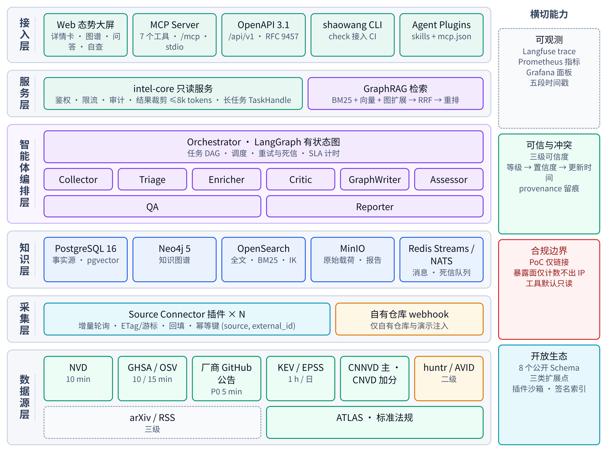
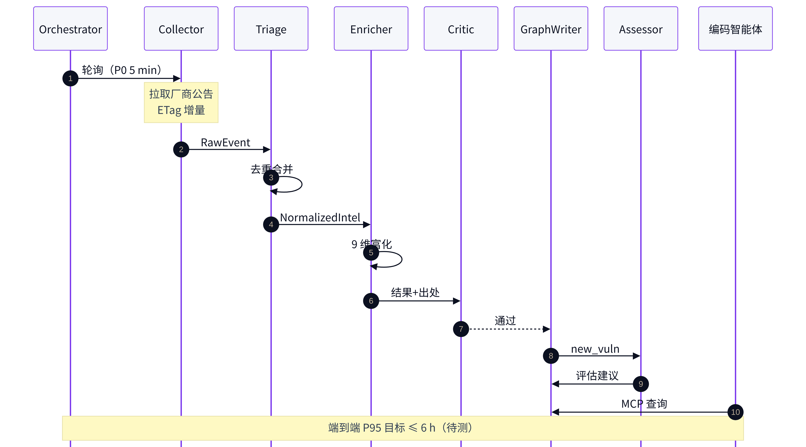
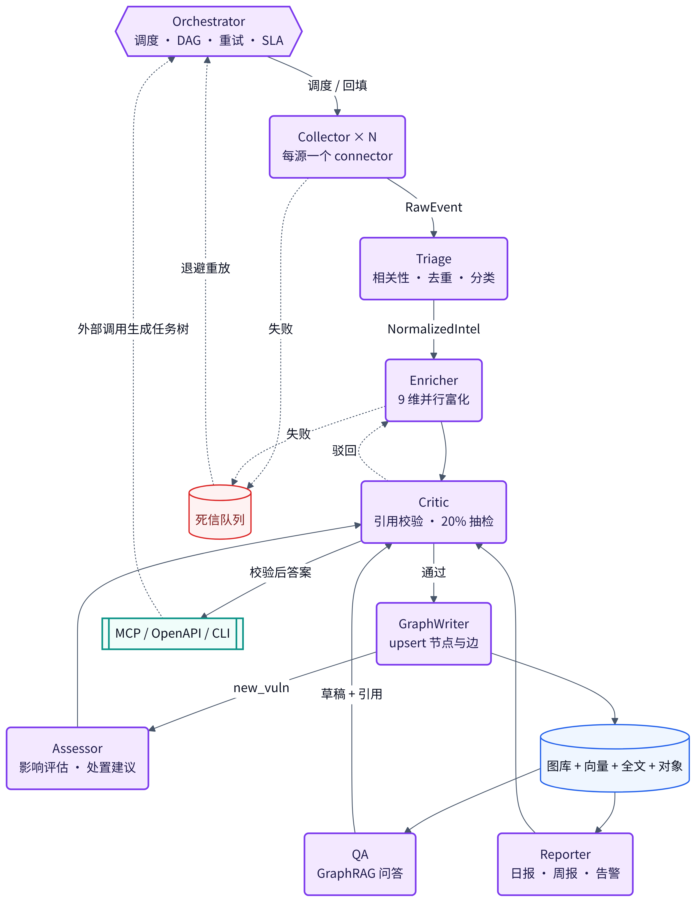
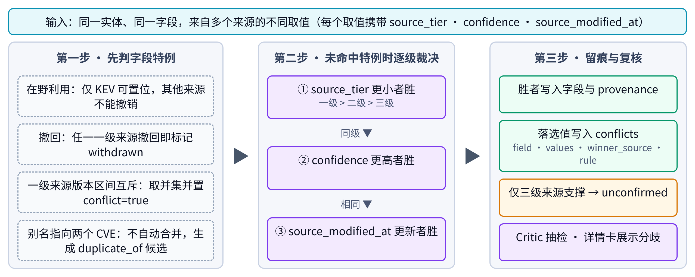
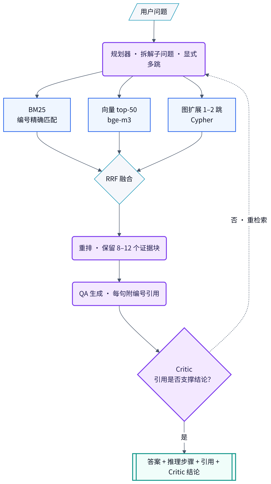
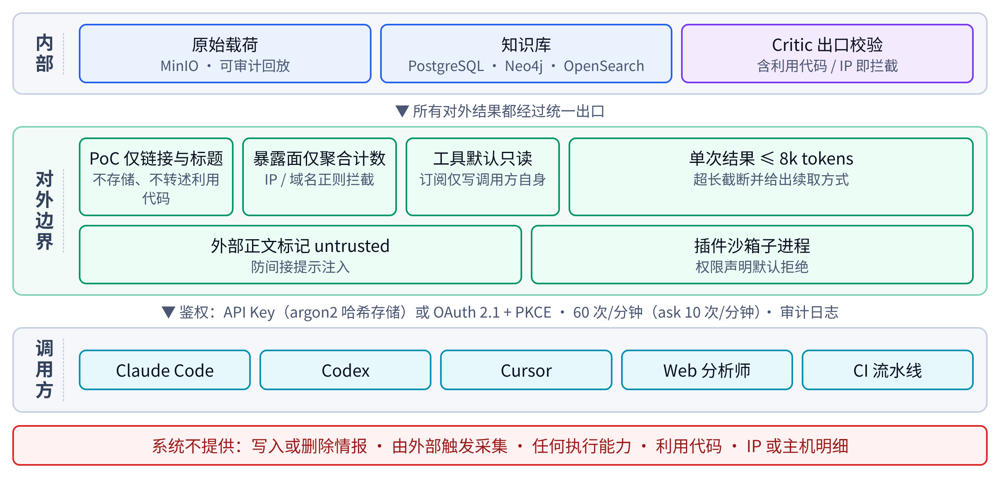

# 写在前面

这份材料写给队里不是安全或 AI 方向的同学。读完以后，你应该能用自己的话把哨望讲清楚：它要解决什么问题、一条漏洞情报在系统里怎么走、每个模块和每个智能体在干什么、我们为什么这样选技术、亮点在哪里、哪些已经做完、哪些还没测。最后有一张术语表和二十多道评委可能会问的问题，答辩前可以拿来自测。

几个约定：

- 文中凡是写“目标”的数字，都是设计目标，还没有实测；凡是写“已实测”的，都有原始记录可查。答辩时这两类数字绝对不能混着说。
- 遇到看不懂的词，先翻到第十二节“术语表”。
- 想快速了解全貌，先读第一、三、九节；想准备问答，重点读第十一、十三节。

**先背一句话：**哨望是一个给防守方用的 AI 安全情报系统。它自动盯着 9 类来源，发现跟 AI 软件有关的漏洞，把每条漏洞的来龙去脉补全、讲清楚彼此的关系，再回答“这个漏洞跟我有没有关系、该怎么修”。系统内部由 9 个各管一摊的智能体协作完成，外部的编程助手（比如 Claude Code、Codex、Cursor）也可以直接调用它。

**30 秒电梯稿（可以直接背）：**现在很多单位都在部署大模型，用 Ollama、vLLM、Dify 这些软件，它们更新快、漏洞也多，可漏洞消息散在几十个地方，权威漏洞库还经常慢好几周。哨望做三件事：第一，盯住官方库、厂商公告、论文博客等 9 类来源，关键厂商每 5 分钟查一次；第二，把每条漏洞补成 9 个维度的完整档案，多个来源说法打架时按规则裁决，自动建立的每条关联都写明理由；第三，像一个懂行的助手一样回答“我用的版本受不受影响、怎么修”，每句话都标出处。整个流程由 9 个智能体分工完成，并且开放给编程助手直接调用。

# 一、我们要解决什么问题

## 1.1 用一个比喻开头

“哨望”这个名字取自古代的瞭望哨：站得高、看得远、一有动静就报信。今天的“动静”，是 AI 软件里的安全漏洞。

想象你是一家公司的安全负责人。公司最近在内网部署了好几套大模型服务：用 Ollama 跑本地模型，用 vLLM 提供推理接口，用 Dify 搭了几个智能客服。某天早上你想知道：昨晚有没有冒出跟这些软件有关的新漏洞？如果有，我们用的版本中招了吗？要升级到哪个版本？

听起来简单，实际上非常麻烦。

## 1.2 三个真实的痛点

**痛点一：消息太分散，权威库还慢。**AI 软件的漏洞消息至少散落在四类地方：美国的国家漏洞库 NVD、GitHub 的安全公告库这类“官方大库”；软件厂商自己在 GitHub 仓库里发的安全公告和版本说明；huntr 这类专门收 AI 漏洞的赏金平台；还有论文和安全博客。只看一个地方，必然漏掉别的。更麻烦的是，大家默认最权威的 NVD 从 2024 年 2 月开始处理不过来了：有统计显示，到 2024 年 5 月，2 月以来新增的漏洞里有 93.4% 还没被分析；到 9 月仍有 72.4% 积压。而 AI 软件几周就发一个新版本，等 NVD 补全信息，黄花菜都凉了。很多厂商公告刚发出来时甚至还没有 CVE 编号，只盯 CVE 的系统会直接漏掉它们。

**痛点二：各家说法不一样，关系也理不清。**同一个漏洞在不同地方“长得不一样”。比如 vLLM 的一个漏洞（CVE-2025-32444），GitHub 公告给的严重程度是 10.0 分，NVD 给的是 9.8 分，另一个数据库还给它起了个别名。Ollama 的一个漏洞，GitHub 写“中危”，发现它的安全公司却说是“严重的远程代码执行”。如果系统把这些原样堆在一起，用户看到的是几张互相矛盾的卡片；如果简单地“谁最新信谁”，又可能让一篇博客推翻官方结论。另外，这个漏洞影响哪些版本、属于哪类攻击手法、有没有论文讨论过、有没有公开的攻击代码，这些信息也散在不同地方，需要有人把它们连起来，还得说清楚“为什么这么连”。

**痛点三：查得到，但回答不了具体问题，也进不了开发流程。**安全人员真正想问的往往是绕了好几道弯的问题，比如“最近 90 天影响 vLLM、已经有公开攻击代码的漏洞有哪些？它们属于哪类攻击手法？我该升到哪个版本？”回答它要先筛组件、再查攻击代码、再查攻击手法、再找修复版本，普通搜索做不到。另一方面，现在很多代码是程序员和编程助手一起写的，选什么依赖、装哪个版本都在编程助手里完成。情报如果只挂在一个网页上，就没法在程序员敲下“安装 vLLM 某个版本”的那一刻提醒他。

## 1.3 我们的边界：只做防守

赛题要求的是“防御侧”系统，这决定了哨望能做什么、不能做什么：

- 我们告诉用户“这个漏洞有没有公开的攻击代码”，但**不保存、不展示攻击代码本身**，只给链接。
- 我们告诉用户“这类软件在公网上大概暴露了多少台”，但**不给任何具体的 IP 地址**，只给数量。
- 我们**不主动扫描**任何人的服务器。
- 对外接口**基本只读**，外部调用不能改我们的情报数据。

这些不是事后补的限制，而是一开始就写进设计的要求，也和国家《网络产品安全漏洞管理规定》的精神一致。

# 二、哨望是什么、干了什么

一句话概括：**监测—富化—问答**三件事，加上**内部多智能体协作**和**对外开放**两个特点。

| 做什么 | 大白话 | 关键数字 |
|---|---|---|
| 监测 | 盯住各个来源，有新漏洞第一时间抓回来 | 9 类来源；关键厂商每 5 分钟查一次 |
| 富化 | 把一条只有标题的消息补成完整档案，并把相关的东西连起来 | 9 个维度；6 类自动关联；每条关联写明理由 |
| 问答 | 用人话回答“跟我有没有关系、怎么修”，每句标出处 | 三路检索 + 多步推理 + 校验 |
| 内部协作 | 9 个智能体各管一摊，有专门的“质检员” | 9 个角色 |
| 对外开放 | 编程助手、命令行、网页、插件都能用 | 7 个 MCP 工具；8 类公开数据格式 |

系统整体分成六层，从下往上依次是：数据源层、采集层、知识层、智能体编排层、服务层、接入层，另外还有四项贯穿各层的能力（可观测、可信裁决、合规边界、开放生态）。下图是总体架构图，答辩时最常用到。

{width=15cm}

看这张图可以这样讲：最下面是我们盯着的 9 类来源；往上一层是一个个“采集插件”，每个来源配一个，负责把数据抓回来；再往上是“知识层”，也就是存数据的地方，有普通数据库、图数据库、全文搜索引擎和文件仓库；中间最大的一层是 9 个智能体，它们是系统的大脑；再往上是统一的服务层，所有对外的请求都从这里进出；最上面是用户能接触到的入口：网页大屏、给编程助手用的 MCP 接口、标准的网页接口、命令行工具和插件包。

为什么要分层？一句话：**把容易变的东西和需要稳定的东西隔开。**外部来源的接口三天两头变，就把它们关在采集插件里；数据格式用公开的规范固定下来，作为各层之间的“合同”；智能体只认这份合同，不关心某个来源长什么样。这样换一个来源、加一个来源，都不用动核心代码。

# 三、一条漏洞情报的完整旅程

这一节用讲故事的方式，把系统从头到尾走一遍。故事里的漏洞是演示用的虚构公告，实际系统中演示数据都带有 DEMO 标记。

## 3.1 上午 10:00：厂商悄悄发了一条公告

vLLM 的开发团队在 GitHub 仓库里发布了一条安全公告：某个组件没有检查输入，可能导致服务被攻击，影响某几个版本，新版本已修复。注意，这条公告**还没有 CVE 编号**，NVD 里自然也查不到。

## 3.2 10:00–10:05：系统发现它（监测）

vLLM 在我们的名单里属于“P0 级”关键厂商，系统每 5 分钟去它的仓库问一次“有没有新公告”。问的方式很节省：带上“上次看到的版本号”，没变化对方就回一句“没变”，不消耗什么资源。这一次有变化，负责这个来源的**采集员（Collector）**把公告原样抓回来，原件存进文件仓库留底，同时记下“第一次看到的时间”。

这里要讲清楚一个细节：我们没法在别人的仓库上装“消息推送”，所以对第三方厂商只能定时去问，这叫**轮询**。我们说的“实时”，在工程上指的是“关键来源分钟级发现”，而不是吹牛说“一秒都不差”。答辩现场为了演示效果，我们准备了一个**演示注入接口**：往我们自己的演示仓库发一条公告，系统通过推送立即触发采集，几秒钟就能看到效果。真实环境和演示环境的数据是分开统计的。

## 3.3 接下来几分钟：判断、合并、编号（分诊）

**分诊员（Triage）**先看这条消息跟 AI 有没有关系：先用关键词和组件名单快速筛一遍，拿不准的再请大模型判断。然后它要回答“这是不是一个我们已经认识的漏洞”：如果别的来源已经有同一个漏洞（比如通过编号对上了），就合并成一条；如果完全是新的又没有任何编号，系统就给它发一个内部编号，格式是 **SW-年份-序号**，比如 SW-2026-0001。等将来它拿到 CVE 编号，系统会自动把两者合并。

## 3.4 再接下来：把档案补全（富化）

**资料员（Enricher）**开始补档案，同时开 9 条线并行干活：

1. 严重程度打多少分（CVSS）
2. 未来被利用的概率有多大（EPSS）
3. 是否已经在现实中被黑客利用（KEV 名单）
4. 属于哪一类软件缺陷（CWE）
5. 对应 AI 攻击手法知识库里的哪一招（ATLAS）
6. 哪些版本受影响、哪个版本修好了
7. 有没有相关的论文和文章
8. 网上有没有公开的攻击代码或检测模板（只记链接）
9. 这类软件在公网上大概暴露了多少台（只记数量）

其中一条线失败了（比如查暴露面的平台临时没响应），只重试这一条，不影响其他 8 条。

如果多个来源对同一个字段说法不一样，资料员不会随便挑一个，而是按固定规则裁决：**先看谁更权威，再看谁更有把握，最后看谁更新**。落选的说法不会被扔掉，会记在“冲突记录”里，用户在详情页能看到“系统为什么选了这个”。

## 3.5 质检：Critic 把关

所有要写进图谱、要给用户看的东西，都要先过**质检员（Critic）**这一关。它检查三件事：引用的证据在库里是否真实存在；把握程度（置信度）够不够；内容里有没有攻击代码或 IP 这类不该出现的东西。大模型给出的“弱关联”（比如“这篇论文讨论的就是这个漏洞”），把握低于 0.6 的不进图谱，只放在候选区等待更多证据。

## 3.6 入库、评估、可以被查到

**档案员（GraphWriter）**把通过质检的结果写进数据库和知识图谱，每条关系都附上理由和置信度。写入新漏洞时，**评估员（Assessor）**马上评估危害：只要满足“已被在野利用”“利用概率高于 0.5”“严重分数 ≥ 9”中的任何一条，就升级为高危并告警。它还会给出处置建议：升到哪个版本；暂时升不了的话，有什么临时缓解办法。

到这一步，这条情报就“可以被查到”了。系统会记下这一刻，和最开始“厂商发布”的时间一比，就得到这条情报的**端到端时延**。我们的目标是 95% 的漏洞情报在 6 小时内完成这一整套流程（目标值，待实测）。

## 3.7 下午 3:00：一位程序员问了个问题（问答）

公司的一位程序员正在 Claude Code（一个编程助手）里写代码，他随口问了一句：“我们项目的依赖有没有受已知 AI 组件漏洞影响？”

编程助手发现自己装了哨望的工具，于是自动调用 `check_stack`（版本自查工具），把项目的依赖清单发过来。哨望逐个比对版本区间，发现项目用的 vLLM 正好落在上午那条公告的影响范围内，于是返回：受影响、严重程度、修复版本、详情链接。程序员接着问“这个怎么修”，编程助手又调用 `ask`（问答工具），哨望的**问答员（QA）**检索证据、组织答案，质检员逐句核对引用后返回，每句话后面都标着出处编号。

同一时间，安全负责人在网页大屏上也看到了这条高危情报，点开详情卡，9 个维度的档案、各来源的说法、系统的裁决理由一目了然。

**整个故事串起来就是：发现 → 分诊合并 → 补全档案 → 质检 → 入库评估 → 被查到 → 回答具体问题。**下面这张时序图画的就是这个过程。

{width=15cm}

# 四、九个智能体各干嘛

可以把哨望想象成一个情报编辑部，9 个智能体就是编辑部里 9 个岗位。

| 角色 | 编辑部里的比喻 | 具体职责 | 关键规矩 |
|---|---|---|---|
| Orchestrator 编排者 | 值班主编 | 排班派活、盯进度、失败了安排重做 | 每个任务的状态都记账，随时可以从断点接着干 |
| Collector 采集员 | 驻外记者 | 每个来源一个，按节奏把新消息抓回来 | 同一条消息抓几次都只算一条 |
| Triage 分诊员 | 收稿编辑 | 判断跟 AI 有没有关系、是不是老熟人、该归哪类 | 先用规则快筛，拿不准再问大模型 |
| Enricher 资料员 | 资料室 | 9 个维度补全档案，裁决多源冲突 | 每个字段都注明“从哪来、谁给的、多有把握” |
| GraphWriter 档案员 | 档案管理员 | 把结果写进数据库和知识图谱 | 每条关系都写明理由和置信度 |
| Assessor 评估员 | 评论员 | 评估危害、给出处置建议 | 升级规则简单透明，能说清楚为什么升级 |
| QA 问答员 | 咨询台 | 回答用户问题，拆解多步问题 | 每句话都要标出处 |
| Critic 质检员 | 审稿校对 | 检查所有要对外的东西 | 证据要能查到，把握要够，不能含攻击代码和 IP |
| Reporter 报告员 | 出版部 | 出日报、周报、告警、大屏指标 | 报告也要过质检 |

{width=12cm}

有三点值得在答辩时强调：

1. **质检员在所有对外出口上。**写入图谱前、评估生效前、答案返回前、报告发布前，都要经过它。这样“质量把关”集中在一个可以单独测试、单独改进的角色上。
2. **智能体之间不闲聊，靠“交接单”协作。**它们不是互相发消息讨论，而是按统一格式交接数据，每一步的输入、输出、状态都记录在案。好处是每一步都能查账，任何一个岗位都能换人（换成规则、换个大模型、换成第三方插件）。
3. **能用规则就不用大模型。**整个系统只有 4 个地方真正调用大模型：分诊时复核、资料员判断弱关联、问答员规划和写答案、质检员判断引用是否站得住。其余都是规则和数据库查询。这样既省钱、又快，还把大模型“胡说八道”的影响限制在可检查的范围内。

# 五、三大模块再讲细一点

## 5.1 监测：盯哪些地方、多久看一次

9 类来源按可信程度分成三级：

| 等级 | 是谁 | 包括 | 权重 |
|---|---|---|---|
| 一级（官方） | 编号机构、政府、官方数据库、软件厂商本身 | NVD、GitHub 已审核公告、OSV、KEV、EPSS、ATLAS、CNNVD、CNVD、厂商公告、标准法规 | 1.0 |
| 二级（专业平台） | 有审核流程的专业平台 | huntr、AVID、GitHub 未审核公告；网络空间测绘平台（只用来数暴露面） | 0.7 |
| 三级（研究资讯） | 论文、博客、新闻 | arXiv、安全博客 | 0.4 |

只有三级来源说有某个漏洞时，系统会标成“未确认”，不发高危告警，回答时也会提醒“目前只有资讯报道，官方尚未确认”。

查看频率按重要程度分档：关键厂商公告 5 分钟一次，GitHub 公告库和 NVD 10 分钟，OSV 和博客 10–15 分钟，huntr 和 KEV 1 小时，AVID 6 小时，EPSS、arXiv、CNNVD 每天一次，标准法规每周一次。CNVD 因为网站有反爬保护，我们不去破解，改为人工导入。

国内来源的选择有个小故事：我们原计划以 CNVD 为国内主力，结果在境内网络实测时发现它的三个入口都返回 521（被反爬拦住了），而 CNNVD 能正常访问，于是改成 CNNVD 为主、CNVD 为加分项。这个“实测后调整方案”的过程，本身就是答辩时很好的素材。

“6 小时”这个指标我们只统计**漏洞类消息的首次发现**（NVD、GitHub 公告、OSV、厂商公告、huntr 这五类），每天才更新一次的来源单独统计，演示数据不算在内。这样既不会被慢来源拖累，也不会用快来源掩盖问题。

## 5.2 富化：档案怎么补、关系怎么连

9 个维度前面已经列过。这里补充三个要点。

**第一，六类自动关联。**系统会自动建立六类“关系”：多个来源描述的是同一个漏洞（合并）；漏洞影响哪个组件的哪些版本；漏洞对应哪种 AI 攻击手法；漏洞被哪些论文和文章讨论过；漏洞该怎么处置；用户的依赖清单是否落在受影响版本里。前两类和最后两类靠规则就能确定，可信度记为 1.0；“对应哪种攻击手法”和“被哪篇论文讨论”属于“弱关联”，要大模型判断、质检员把关。

**每条关系都必须写明理由。**比如“GitHub 公告的别名字段里写着这个 CVE 编号”，或者“论文摘要与漏洞描述的语义相似度很高，并且都提到了 vllm”。用户在图谱里点任何一条连线，都能看到“为什么连”。

**第二，冲突裁决。**下面这张图画的是“多个来源说法不一样时怎么办”。先看四种特殊情况：是否已被在野利用只能由 KEV 说了算；任何一个官方来源宣布撤回，这条漏洞就标记为撤回；两个官方来源给的受影响版本对不上，就取并集（宁可多报，不可漏报）并提示有分歧；一个编号同时指向两个不同漏洞时，不自动合并，交人工确认。其余情况按“权威程度 → 把握程度 → 更新时间”依次比较。

{width=15cm}

**第三，版本自查。**用户把依赖文件（比如 Python 项目的 requirements.txt）交给系统，系统逐个比对版本区间，给出三种结论：受影响、没发现已知影响、这个组件我们没收录。特意把“没收录”单独列出来，是为了不让用户产生“没报问题就是安全”的错觉。命令行工具发现高危时会返回错误码 1，可以直接放进自动化流水线，有高危依赖就不让代码合并。

**关于暴露面（第 9 维）的一个真实经历。**我们用 360 Quake 测绘平台查 Ollama 在公网上的数量，第一次用比较宽的查询条件，结果是约 82 万（精确值 823 690），而思科的研究团队用另一个平台只数出 1139 个。差了近三个数量级，说明查询条件太宽，把很多无关的东西也算进来了。我们改成“默认端口 11434 且网页内容包含 Ollama is running”这个更严格的条件，全球降到约 17.2 万，其中国内约 5.2 万；再随机抽 50 条只看基本信息核对，44 条确实是 Ollama，精确率 88%，超过我们定的 80% 上线门槛。整个过程只取数量，不保存任何 IP。这组数字是 2026 年 10 月 15 日的实测结果。

## 5.3 问答：怎么做到“答得准、说得清”

问答要同时对付两类问题：一类要求一字不差，比如“CVE-2025-32444 影响哪些版本”，编号差一位就是另一个漏洞；另一类要求理解意思，比如“推理服务里有哪些反序列化导致的远程执行问题”，问题里一个编号都没有。所以我们同时用三种方式找资料：

- **关键词检索（BM25）**：擅长精确匹配编号、版本号、组件名。
- **向量检索**：把文字变成“意思坐标”，找意思相近的内容，中英文混着问也行。
- **图扩展**：从找到的漏洞、组件出发，沿着知识图谱的关系往外走一两步，把“文字上不像、逻辑上相关”的证据找回来，比如某漏洞的修复版本。

三路结果用一种叫 **RRF** 的方法合并（只看各路的排名，不看原始分数），再用一个更精细的模型重新排序，最后挑出 8–12 段最相关的证据交给大模型写答案。

遇到绕弯子的问题，问答员会先把它**拆成几步**。比如“近 90 天影响 vLLM、有公开攻击代码链接的漏洞有哪些，对应什么攻击手法”，会拆成：找影响 vLLM 的漏洞 → 筛出有攻击代码链接的 → 只留近 90 天的 → 查对应的攻击手法。每一步查了什么、找到几条，都显示给用户看。答案写好后，质检员逐句核对：引用的资料是否真实存在、是否真的支持这句话。不受支持的句子不超过 30% 时，答案照常返回，但会把这些句子标出来；超过了就重新检索再答。

{width=10cm}

# 六、对外开放：谁都能用，但只能看不能改

哨望对外有四种用法：给编程助手用的 **MCP 接口**、标准的 **网页 API（OpenAPI）**、**命令行工具 shaowang**、以及打包好的**插件包**。四种用法背后是同一个服务层，所以身份验证、限流、调用记录只做一套。

MCP 接口提供 7 个工具：

| 工具 | 干什么 | 能不能改数据 |
|---|---|---|
| search_vulns | 按关键词、组件、严重程度等条件搜漏洞 | 只读 |
| get_vuln | 查一条漏洞的完整档案 | 只读 |
| check_stack | 把依赖清单交给它，查受不受影响 | 只读 |
| ask | 用自然语言提问，跨文档推理回答 | 只读 |
| get_task_result | 取回耗时长的任务结果，也用来取日报周报 | 只读 |
| list_sources | 看各个来源的健康状况和时延 | 只读 |
| subscribe_alerts | 订阅某些组件的告警 | 唯一能写的，而且只写调用者自己的订阅，可选实现 |

几个设计细节：结果一次不超过 8k tokens（编程助手一次能“读”的量有限）；预计超过 60 秒的请求会先返回一个“取件号”，之后凭号来取结果，因为编程助手对单次调用有超时限制；攻击代码只给链接。

**插件生态**：我们公开了 8 类数据格式规范，可以和国际通用的 OSV、STIX 2.1、CSAF 2.0 格式互相转换；第三方可以写三类插件——新的数据源、新的富化维度、新的对外工具。插件权限默认全部拒绝，要什么权限得事先声明、管理员批准；插件在隔离的环境里运行，不能直接写我们的图谱。SDK 用 Apache-2.0 许可证开源。

# 七、为什么选这些技术

| 用途 | 选了什么 | 大白话理由 | 也考虑过 |
|---|---|---|---|
| 智能体编排 | LangGraph（有状态图） | 每一步都存档，出错能从断点重来，评委能查账 | AutoGen、CrewAI（对话式，灵活但难审计） |
| 消息队列 | Redis Streams 或 NATS | 比赛规模下最轻量，自带失败消息的处理 | Kafka（规模大时再用） |
| 主数据库 | PostgreSQL + pgvector | 普通数据和“意思坐标”放一个库，省得两边对不齐 | 独立向量库 Milvus |
| 知识图谱 | Neo4j | 查“沿着这条关系再沿着那条关系”特别直观 | Apache AGE |
| 全文搜索 | OpenSearch + IK 中文分词 | 精确匹配编号稳，中文分词成熟 | Meilisearch |
| 文字理解模型 | bge-m3（向量）+ bge-reranker（重排） | 中英文都好，可以在本地部署 | 商业接口 |
| 大模型 | 国产大模型 API | 中文好，可以换成本地部署的开源模型 | 本地 vLLM 部署 |
| 后端 | FastAPI | 和 Python 生态统一，自动生成接口文档 | Litestar |
| 前端 | React + ECharts + Cytoscape.js | 图表和关系图组件多 | Vue 3 |
| 监控 | Langfuse、Prometheus、Grafana | 智能体每次调用和时延指标都能看到 | — |
| 部署 | docker compose | 评委一条命令就能把整套系统跑起来 | Kubernetes |

答辩时常被追问的两点：**为什么用两个数据库（PostgreSQL 和 Neo4j）？**因为“多跳关系查询”用普通数据库写起来要绕好几层，图数据库一句话就能表达；代价是要保证两边一致，我们以 PostgreSQL 为准，再同步到图库。**为什么不用对话式多智能体框架？**因为情报流水线大部分步骤是确定的，我们更需要“每一步可审计、失败可重放”，有状态图天然满足。

# 八、安全合规：我们刻意不做的事

{width=13cm}

- **不存 IP**：暴露面只存“全球约多少、国内约多少、各版本各多少”，查询结果里的资产明细在内存里就丢掉，不落盘、不写日志；输出前还会用规则再拦一遍。
- **不存攻击代码**：只存链接、标题和类型；输出前删除任何像代码或攻击载荷的内容；问答员拒绝“帮我写攻击脚本”“列出暴露的 IP”这类请求。
- **不主动扫描**：暴露面数据来自测绘平台已有的统计，我们不向任何服务器发探测包。
- **对外只读**：7 个工具里 6 个只读，唯一能写的只写调用者自己的订阅。
- **防“间接提示注入”**：外部网页、博客的正文被当成“数据”而不是“指令”交给大模型，防止有人在网页里藏一句“忽略之前的要求”来劫持系统。
- **密钥不外露**：所有平台密钥通过环境变量注入，代码、文档、日志里都不出现真实值，提交前有自动扫描。

# 九、亮点与评分对应

赛题满分 100 分。下表是七项创新点和评分项的对应关系，答辩时可以按这个顺序讲。

| # | 亮点（一句话） | 为什么算创新 | 对应评分项 |
|---|---|---|---|
| 1 | 面向 AI 软件的多源融合，没编号的厂商公告也能抓 | 别人以 CVE 为中心，我们 5 分钟盯厂商、自发编号，不等权威库；多源打架有规则裁决 | 监测 15、时效 5 |
| 2 | 自动关联，并且每条关联都说得清理由 | 能用规则就不用大模型；理由、置信度、方法是数据格式里的必填项 | 富化 15、富化准确 5 |
| 3 | 读依赖文件回答“我受不受影响” | 从“有哪些漏洞”变成“哪些跟我有关”；能接进自动化流水线拦截 | 富化 15、Agent 15 |
| 4 | 可解释的多跳问答 | 三路检索兼顾精确与语义；推理步骤可见；返回前逐句核对引用 | 问答 15、问答准确 5 |
| 5 | 内部 9 智能体编排 + 对外 MCP 开放 | 内部每步可审计；外部编程助手直接调用，6/7 工具只读 | Agent 架构 15 |
| 6 | 时效看得见、出错能自愈 | 五段时间戳公开时延；重试、失败队列、熔断、备用通道 | 时效 5、自动化 10 |
| 7 | 开放、安全的插件生态 | 8 类公开格式对接国际标准；插件默认无权限、隔离运行、签名校验 | Agent 15、文档 15 |

各评分项满分分布：功能（监测 15、富化 15、问答 15）、性能（时效 5、富化准确 5、问答准确 5）、Agent 架构 15、自动化 10、文档 15。

# 十、“自愈”是怎么回事

外部来源经常出状况：被限流、临时宕机、改了格式。系统的处理办法：

- 遇到“请求太频繁”或服务器临时出错，先按对方说的时间等；对方没说，就 1 秒、2 秒、4 秒……翻倍等待再试，最长等 5 分钟，还加一点随机，避免所有任务同时重试。最多试 6 次。
- 6 次还不行，放进“死信队列”（相当于“待处理文件夹”），每 15 分钟统一再试一次。
- 如果是请求本身写错了（比如参数不对），重试也没用，直接放进死信队列并告警。
- 一个来源连续 3 个周期都失败，就“熔断”，标成“降级”，切换到事先准备的备用通道：比如 NVD 不行就去 CVE 官方仓库取，arXiv 的接口不行就改用它的 RSS，KEV 不行就读 NVD 里的相关字段。
- 智能体进程崩溃了，重启后从上次记账的地方接着干。

# 十一、诚实说明：哪些做完了，哪些还没测

这一节答辩时要特别注意口径。

## 11.1 已经完成的

- **完整方案设计**：架构、9 类数据源规格、9 维富化、问答设计、7 个 MCP 工具的接口定义、8 类公开数据格式、插件规范、界面设计、演示脚本、测绘数据计划、附录实践记录计划，以及一份 91 页的技术报告初稿。
- **境内网络连通性实测（2026-10-14，境内网络）**：NVD、GitHub、OSV、KEV、EPSS、huntr、ATLAS 都能直接访问（HTTP 200），部署不需要代理；CNNVD、TC260 正常；CNVD 三个入口都是 521（反爬）；arXiv 的 export 接口返回 502；鹰图 Hunter 首页境内可访问，接口还没测；FOFA 接口通但积分不足（返回 820031）；ZoomEye 的鉴权方式和文档对不上，还没核实。
- **暴露面查询校准（2026-10-15）**：Quake 上 Ollama 宽口径 823 690，收窄后全球 172 411、国内 51 612，50 条抽样精确率 88%。原始记录只有数量，并做了哈希留存和脱敏扫描（0 个密钥、0 个 IP 命中）。
- **由实测驱动的三处方案调整**：国内主力从 CNVD 改为 CNNVD；arXiv 改以 RSS 为主；暴露面查询语法收窄并建立“抽样精确率 ≥80% 才上线”的规矩。
- **口径统一**：各文档之间 13 处不一致已统一，例如内部编号从早期的 AISI-/AISV- 统一为 SW-（避免和英国 AI 安全研究所的缩写撞车）。

## 11.2 正在做或要以仓库为准的

- 报告第三章的 6 段核心代码是按设计写出的参考实现节选，文件路径和函数名要和最终代码仓库对齐。
- 系统各模块的编码、联调按里程碑推进，具体完成到哪一步，答辩前以仓库和演示为准，不要凭印象说“全部完成”。

## 11.3 还没测的（答辩时只能说“目标是……，正在测”）

- 端到端时延 P95（目标 ≤6 小时）、关键厂商采集时延 P95（目标 ≤10 分钟）、实际稳定接入的来源类别数（目标 ≥7 类）
- 200 条金标集上的富化与关联准确率（目标 ≥95%）、标注一致性
- 约 100 题问答评测的答案准确率、引用正确率、多跳题准确率（三组对照）
- 故障注入下的自愈成功率和恢复时间
- Claude Code、Codex、Cursor、Gemini CLI 的实际接入测试
- 鹰图 Hunter 的境内接口和其他 9 个组件的暴露面数据
- 9 张系统界面截图（报告里现在是灰色占位图）

**答辩口径：**被问到没测的指标，就说“设计目标是多少、评测方法是什么、目前在测”，绝不报一个估计值。评委最反感编出来的数字，最欣赏讲得清方法、承认还没做完的团队。

# 十二、术语表

| 术语 | 一句话解释 | 打个比方 |
|---|---|---|
| 漏洞 | 软件里可以被坏人利用的缺陷 | 房子的门锁有个设计缺陷 |
| CVE | 全球通用的漏洞编号，如 CVE-2024-37032 | 漏洞的“身份证号” |
| GHSA | GitHub 给漏洞公告起的编号 | GitHub 发的“临时身份证” |
| OSV | 一个开放的漏洞数据库和数据格式，特别擅长描述受影响的版本区间 | 带“适用范围”的药品说明书 |
| NVD | 美国国家漏洞库，最常用的权威漏洞库 | 官方的“漏洞户籍所” |
| CVSS | 漏洞严重程度评分，0–10 分 | 病情的“危重等级” |
| EPSS | 预测一个漏洞未来 30 天被利用的概率 | 天气预报里的“降雨概率” |
| KEV | 美国 CISA 维护的“已被在野利用”漏洞名单 | “已经有人中招”的通缉榜 |
| CWE | 软件缺陷的分类目录 | 疾病分类目录 |
| ATLAS | MITRE 维护的 AI 系统攻击手法知识库 | 针对 AI 的“兵法大全” |
| CNNVD / CNVD | 我国两个国家级漏洞库 | 国内的“漏洞户籍所” |
| PoC | 证明漏洞真实存在的演示代码，往往可直接用来攻击 | 开锁演示视频——我们只记“有这个视频”，不转发视频 |
| 暴露面 | 某种软件在公网上能被直接访问的数量 | 街上有多少家没锁门的店 |
| 网络空间测绘 | 统计公网上各种设备和服务的平台，如 Quake、鹰图 Hunter | 互联网的“人口普查局” |
| 情报富化 | 给一条原始消息补全背景信息 | 把一条新闻线索扩写成完整档案 |
| 知识图谱 | 用“点”和“连线”存储事物及其关系的数据库 | 侦探墙上用红线连起来的照片 |
| 置信度 | 系统对一个结论有多大把握，0–1 | “我有八成把握” |
| provenance（来源记录） | 每个数据从哪来、谁给的、什么时候、多有把握 | 文物的“出土记录” |
| 向量检索 | 把文字变成“意思坐标”，按意思找相近内容 | 按“味道相似”找菜，而不是按菜名 |
| BM25 | 经典的关键词检索打分方法 | 按“关键词出现得多不多”翻书 |
| RRF | 把几路搜索结果按排名合并的方法 | 几位评委各自排名，再按名次汇总 |
| 重排（rerank） | 用更精细的模型对候选结果重新排序 | 海选之后的复赛 |
| RAG | 先检索资料、再让大模型基于资料回答 | 开卷考试 |
| GraphRAG | 检索时还沿着知识图谱的关系找资料 | 开卷考试时还能顺着目录和交叉引用翻 |
| 多跳推理 | 需要连续几步查找才能回答的问题 | 先查“谁是他爸”，再查“他爸住哪” |
| 智能体（Agent） | 能自主调用工具、完成一类任务的 AI 程序 | 编辑部里有专职的员工 |
| 编排（Orchestration） | 安排多个智能体谁先谁后、怎么交接 | 主编排版排班 |
| 有状态图（LangGraph） | 把流程画成带“存档点”的流程图来执行 | 带存档的游戏关卡 |
| Critic | 专门检查别人产出的智能体 | 审稿人 |
| MCP | 让 AI 助手调用外部工具的统一协议 | AI 世界的 USB 接口 |
| 编程助手 / Coding Agent | 帮程序员写代码的 AI，如 Claude Code、Codex、Cursor | 会写代码的助理 |
| SKILL.md | 告诉 AI 助手“什么时候、怎么用这个工具”的说明书 | 工具的使用说明卡 |
| API / OpenAPI | 程序之间互相调用的接口及其标准描述格式 | 餐厅的点菜窗口和菜单 |
| CLI | 命令行工具 | 在终端里打字下指令 |
| CI（持续集成） | 代码提交后自动跑检查的流水线 | 工厂流水线上的质检关卡 |
| 轮询 | 定时主动去问“有没有新东西” | 每 5 分钟去信箱看一眼 |
| webhook | 对方有新东西时主动通知你 | 快递到了给你打电话 |
| 幂等 | 同一个操作做几次，结果都一样 | 电梯按钮按十次也只去一次 |
| 死信队列 | 多次处理失败的任务暂存的地方 | “待处理”文件夹 |
| 熔断 / 降级 | 某个来源老出错就先停用，改走备用方案 | 主路堵了走辅路 |
| P50 / P95 | 一半 / 95% 的样本都不超过的值 | 95% 的快递都在这个时间内送达 |
| 端到端时延 | 从来源发布到系统里能查到的总时间 | 从新闻发生到登上报纸 |
| JSON Schema | 规定数据长什么样的格式规范 | 填表须知 |
| STIX / CSAF | 国际通用的威胁情报格式和安全公告格式 | 国际通用的“公文格式” |
| 沙箱 | 隔离运行程序的环境，出事也影响不到外面 | 实验室里的通风橱 |
| 提示注入 | 在文字里藏指令，诱骗大模型做不该做的事 | 在信里夹一张“请把钥匙交给送信人”的纸条 |
| 金标集 | 人工标注好正确答案、用来考系统的数据集 | 标准答案卷 |

# 十三、评委可能提问及参考回答

**Q1：你们这个系统和直接去 NVD 查有什么区别？**
答：三点。第一，NVD 只收有 CVE 编号的漏洞，而且从 2024 年起分析积压严重；我们每 5 分钟直接盯关键厂商的公告，没有编号的也先入库。第二，NVD 只是一个来源，我们汇集 9 类来源，说法不一致时按规则裁决并保留分歧。第三，NVD 只能查，我们能回答“我的版本受不受影响、怎么修”，还能被编程助手直接调用。

**Q2：你们说“实时监测”，第三方仓库又装不了 webhook，怎么实时？**
答：我们对“实时”的定义是工程上可兑现的：关键厂商每 5 分钟轮询一次，用条件请求，没变化不消耗资源，目标是关键来源 10 分钟内发现。webhook 只用于我们自己的仓库和演示注入。我们不会说“秒级”，而是把每个来源的实际时延用 P50/P95 公开在大屏上。

**Q3：9 类数据源都接上了吗？**
答：设计是 9 类，赛题优秀档要求至少 7 类。境内连通性已经实测过，主要境外源都能直连。实际稳定运行的类别数要连续运行观测后统计，这个数字目前在测，我们不会提前报。

**Q4：多个来源说法不一样，你们信谁？**
答：逐个字段裁决，顺序是“来源等级 → 置信度 → 更新时间”。另有四种特殊规则，比如“是否在野利用”只认 KEV。选出主值的同时，落选的说法和裁决理由都保留，用户在详情页能看到。

**Q5：大模型会胡编关联吧？你们怎么控制？**
答：三层控制。第一，能用规则确定的关联（编号合并、版本区间）一律用规则；只有“对应哪种攻击手法”“哪篇论文相关”这类弱关联才用大模型。第二，大模型必须给出置信度和理由，低于 0.6 的不进图谱。第三，Critic 按 20% 比例抽检，并用 200 条人工标注的金标集定期回归。

**Q6：问答怎么保证不瞎说？**
答：每句话都必须带引用编号；生成之后、返回之前，Critic 逐句检查引用的资料是否真实存在、是否真的支持这句话。不受支持的句子会被明确标出来；比例太高就重新检索。我们还设计了三组对照实验来量化这一步的作用，结果在测。

**Q7：为什么要 9 个智能体？是不是为了凑数？**
答：不是越多越好，而是让每个角色职责单一、输入输出可以单独检查和替换。最关键的是把“质检”独立成 Critic，放在所有对外出口上。智能体之间通过统一格式交接，每一步都可审计。如果某个角色用规则就能做好，它内部就是规则，不一定调用大模型。

**Q8：为什么用 LangGraph，不用 AutoGen 这种多智能体对话框架？**
答：对话式框架适合开放任务，但情报流水线大部分步骤是确定的，我们更需要每一步可审计、失败可从断点重放。LangGraph 把流程建成有状态的图，每个节点的状态都持久化，正好满足。

**Q9：暴露面 82 万这个数是真的吗？会不会误导？**
答：82 万是我们第一次用宽口径查询的真实结果，但我们自己判断它不能用——思科研究团队用另一平台只数出 1139 个，差了近三个数量级，说明查询条件太宽。我们把条件收窄到“默认端口加特征响应”，全球约 17.2 万、国内约 5.2 万，再抽样 50 条核对，精确率 88%。宽口径只作上限参考，不在大屏展示。不同平台口径不同，我们也不跨平台相加。

**Q10：查暴露面会不会碰到合规问题？**
答：我们只调用测绘平台的计数，查询结果里的资产明细在内存里直接丢弃，不保存、不展示、不导出任何 IP，也不对任何目标发包。系统里有数据格式限制和输出拦截两道保险，原始记录还做过脱敏扫描。这和《网络产品安全漏洞管理规定》中不得发布在用系统漏洞细节的要求是一致的。

**Q11：你们会存 PoC 吗？那不就成了攻击工具库？**
答：不存。我们只记录“有没有公开的 PoC 或检测模板”，以及链接、标题和类型。这对防守方很有用：有公开 PoC 的漏洞更容易被利用，应该优先修。输出前还会过滤掉任何像代码或攻击载荷的内容，问答也拒绝生成利用步骤。

**Q12：MCP 是什么？为什么要做？**
答：MCP 是让 AI 助手调用外部工具的统一协议，可以理解为 AI 世界的 USB 接口。现在很多依赖选择是在编程助手里完成的，我们做了 MCP 接口，Claude Code、Codex、Cursor 这些工具装上就能在写代码时直接查漏洞、做版本自查，把安全提醒提前到写代码的那一刻。

**Q13：外部智能体调用你们，会不会把你们的数据改乱？**
答：不会。7 个工具里 6 个是只读的，唯一能写的 subscribe_alerts 只写调用者自己的订阅，而且是可选功能。系统里根本没有“写入情报”“删除情报”“触发采集”这类对外工具。所有调用都要鉴权、限流，并写审计日志。

**Q14：工具调用超时怎么办？比如深度问答要好几分钟。**
答：主流编程助手对单次工具调用通常有 60 秒左右的超时。我们在调用前先估计耗时，预计超过 60 秒就立即返回一个任务编号，助手之后用 get_task_result 取结果。这样不会卡住，也不会重复执行。

**Q15：6 小时时效怎么算？演示时几秒就出来了，是不是作弊？**
答：时效从“来源发布时间”算到“系统里可以查到”的时间，只统计漏洞类消息的首次发现。演示注入的数据带 DEMO 标记，不计入统计，大屏上有口径开关，可以对比展示。真实数据的 P95 要连续运行至少 7 天后统计，目前在测。

**Q16：富化准确率 95% 是怎么来的？**
答：95% 是设计目标，不是实测值。我们会用 200 条人工标注的金标集评测，样本里专门加入了没 CVE 的公告、别名冲突、评分不一致等难例，每条两人独立标注、第三人仲裁，并按关联类型分别统计，不只给一个总数。

**Q17：如果某个数据源挂了，系统会怎样？**
答：先按退避策略重试，最多 6 次；还不行进入死信队列，每 15 分钟重放。一个来源连续 3 个周期失败就熔断，切到备用通道，比如 NVD 挂了改从 CVE 官方仓库取数据。期间系统照常服务，只是那个维度的时效或覆盖下降，界面上会明确提示。

**Q18：国内的漏洞库你们接了吗？**
答：接了 CNNVD 作为国内主力，每天采集一次元数据。原计划用 CNVD，但境内实测三个入口都被反爬拦截（HTTP 521），我们不做反爬绕过，所以把 CNVD 降为加分项，通过人工或有人参与的低频方式导入。

**Q19：别人怎么给你们写插件？会不会有安全风险？**
答：我们公开了 8 类数据格式和三类扩展点（数据源、富化器、对外工具），提供 Python SDK 和模板。安全上：插件权限默认全拒，网络只能访问声明过的域名，拿不到别的密钥，不能写图谱；插件在隔离的子进程里运行；提交时自动跑六项检查，插件索引带签名。

**Q20：你们的数据能导出给别的平台吗？**
答：可以。我们的数据格式和 OSV、STIX 2.1、CSAF 2.0 三个国际标准都做了字段映射，提供导出工具，可以无损地进入其他情报平台。

**Q21：为什么同时用 PostgreSQL、Neo4j 和 OpenSearch，不嫌复杂吗？**
答：三者各管一件事：PostgreSQL 是事实源，存规范化数据并兼存向量；Neo4j 负责多跳关系查询；OpenSearch 负责精确的关键词检索。合在一个库里要么查不动、要么写起来很绕。为了避免不一致，以 PostgreSQL 为准，用 outbox 机制同步到另外两个。部署用 docker compose，一条命令就能起来。

**Q22：你们和 OpenCTI、MISP 这些开源情报平台比有什么不同？**
答：它们以通用威胁指标为中心，擅长存储和共享，但缺少针对 AI 软件的数据源、版本区间推理和 ATLAS 映射；自动关联一般不记录理由和置信度；主要面向分析师的界面，而不是编程助手的接口。我们借鉴了知识图谱的组织方式，但把“每条边必须有理由”写成硬规定，并面向智能体开放。

**Q23：这个系统的不足是什么？**
答：坦白讲有三点：一是大模型产生的弱关联仍会有误差，需要靠 Critic 和金标集持续校准；二是暴露面依赖第三方测绘平台的口径，只能作为影响范围的参考，vLLM、Triton 等组件的查询条件还没验证；三是 CNVD 受反爬限制只能人工导入。另外各项性能指标还在实测中。

**Q24：用了大模型，成本和速度怎么控制？**
答：全系统只有 4 处调用大模型，其余都是规则和数据库查询。分诊先用关键词快筛，只把拿不准的交给大模型；每个智能体有每日 token 预算，超了就退回只用规则。模型通过统一网关调用，可以换成本地部署的开源模型。

**Q25：项目现在做到什么程度了？**
答：方案设计已经完成，境内连通性和暴露面查询已经实测，并据此调整了方案；系统按里程碑推进编码和联调；时延、准确率、问答质量、自愈和编程助手兼容性的评测方法已经定好，正在实测，报告里对应位置都明确标了“待测”。

# 十四、答辩速记卡

**必须记住的数字（都是设计参数或实测事实）**：9 类来源、三级可信度（权重 1.0/0.7/0.4）、P0 厂商 5 分钟、9 维富化、6 类关联、9 个智能体、7 个 MCP 工具（6 只读）、8 类公开数据格式、3 类扩展点、5 段时间戳、7 项创新点；弱关联入图门槛 0.6、Critic 抽检 20%、重试最多 6 次、死信 15 分钟重放、连续 3 次失败熔断、结果 ≤8k tokens、60 秒转异步、限流每分钟 60 次（ask 10 次）。

**只能说“目标”的数字**：端到端时延 P95 ≤6 小时、P0 采集 ≤10 分钟、富化准确率 ≥95%、问答各项指标。

**可以说“已实测”的数字**：境内连通性结果（2026-10-14）；Quake 上 Ollama 宽口径 823 690、收窄后全球 172 411、国内 51 612、抽样精确率 88%（2026-10-15）。

**不要说的话**：“全部完成了”“准确率达到 95%”“秒级实时”“国内首创”“我们存了 PoC 方便研究”“可以查到具体哪些 IP 暴露了”。
